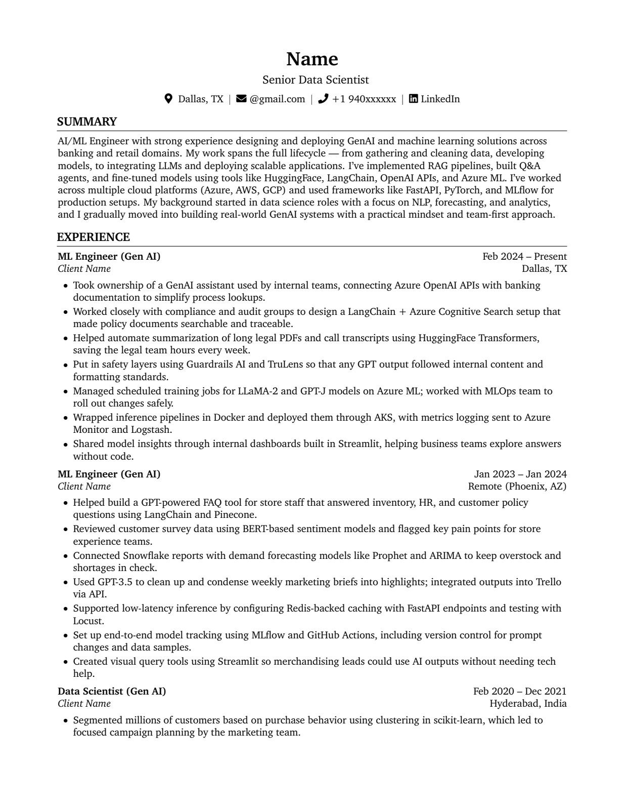
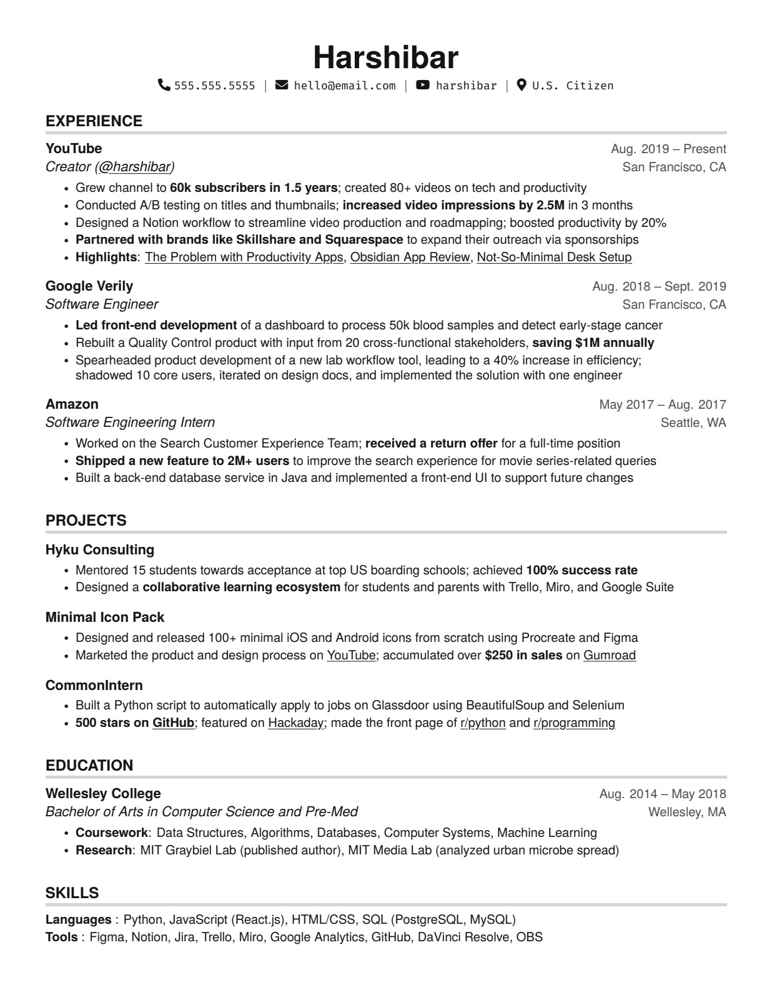
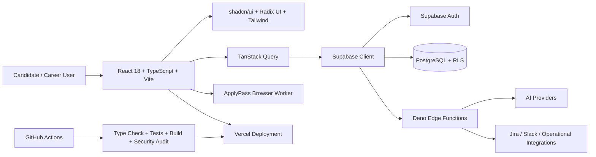

<div align="center">
  

# ResumePreps — AI Career Command Center

**Build ATS-ready resumes, generate tailored career materials, track applications, and run enterprise-grade career workflows from one intelligent workspace.**


</div>

---

## Navigation

- [Why this repo stands out](#why-this-repo-stands-out)
- [Product preview](#product-preview)
- [Experience map](#experience-map)
- [Architecture](#architecture)
- [Quality and validation](#quality-and-validation)
- [Enterprise-readiness path](#enterprise-readiness-path)
- [Tech stack](#tech-stack)
- [Getting started](#getting-started)
- [Documentation index](#documentation-index)
- [Roadmap](#roadmap)
- [Security posture](#security-posture)
- [Portfolio README standard for sibling repos](#portfolio-readme-standard-for-sibling-repos)

---

## Why this repo stands out

ResumePreps is more than a resume builder. It is a full-stack AI career operating system with resume intelligence, guided job-search workflows, browser-assisted applications, governance automation, and enterprise-readiness foundations in one production-oriented codebase.

| Signal | Proof |
| --- | --- |
| **ATS quality validated** | 27 ATS validation tests passed with a 97.5/100 average score |
| **Career workflow coverage** | Resumes, cover letters, interview prep, job search, tracking, and ApplyPass automation |
| **Enterprise direction** | SSO, RBAC, audit logging, tenant isolation, and admin portal blueprint |
| **Release discipline** | Type-check, test, build, lint, security audit, E2E, and executive brief scripts |
| **Modern architecture** | React + TypeScript frontend, Supabase backend, Deno Edge Functions, Vercel delivery |

---

## Product preview

<div align="center">
  
</div>

> **Live demo:** deployment is configured for Vercel, but no public demo URL is documented in this repository yet. Add the production URL here once it is ready to share.

### Resume templates

| Professional | Creative |
| --- | --- |
|  |  |

---

## Experience map

| Surface | What it does | Why it matters |
| --- | --- | --- |
| **Resume Builder** | Structured editing, templates, live previews, exports, ATS checks | Turns raw career history into polished, recruiter-ready documents |
| **AI Career Workspace** | Chat-driven resume, cover letter, interview, and search assistance | Keeps career strategy and content creation in one guided flow |
| **ATS Intelligence** | Keyword matching, formatting checks, scoring, and regression validation | Helps candidates understand whether resumes survive automated screening |
| **Job Search & Tracking** | Saved jobs, application status, matching, analytics, and collections | Converts job search chaos into an operational pipeline |
| **ApplyPass Automation** | Assisted application flows and browser-worker support | Reduces repeated application friction while preserving user control |
| **Admin & Control Center** | Owner-only operations, executive briefs, governance, and release monitoring | Adds the operational layer expected from serious SaaS products |

---

## Architecture



### System layers

```text
src/                    React application source
  components/           Shared UI, product surfaces, layouts
  pages/                Route-level pages
  hooks/                Reusable React hooks
  lib/                  Utilities, analytics, scoring, domain logic
  integrations/         Supabase client and generated types
supabase/
  functions/            Supabase Edge Functions for server-side workflows
  migrations/           PostgreSQL schema, policies, and product data model
scripts/                Operations, governance, metrics, and automation scripts
docs/                   Product, operations, readiness, and validation docs
qa/                     QA execution reports and validation artifacts
.github/workflows/      CI, remote-agent, and release automation
```

---

## Quality and validation

### ATS validation results

Based on `docs/ats-validation-report.md`:

| Metric | Result | Target | Status |
| --- | ---: | ---: | --- |
| ATS validation tests | 27 passed | 20+ | PASS |
| Average ATS score | 97.5/100 | >85 | PASS |
| Score variance | 1.15% | <5% | PASS |
| Keyword match rate | 62–72% | >50% | PASS |
| Critical issues | 0 | 0 | PASS |

### QA coverage scaffold

Based on `qa/TEST_EXECUTION_REPORT.md`:

| Layer | Coverage |
| --- | --- |
| Unit | LaTeX compilation, syntax validation, special characters, large document edge cases |
| Integration | PDF, DOCX, JSON export workflows and multi-format consistency |
| E2E | Signup/login, resume creation, ATS check, AI chat, cover letter, voice interview, job search |
| Regression | Authentication, routes, AI flows, critical flows, build and deployment checks |

### Release gates

```sh
npm run type-check
npm run test
npm run build
npm run lint
```

Or run the consolidated release gate:

```sh
npm run hq:gate
```

Additional confidence commands:

```sh
npm run security:audit       # Secret-leak and security-oriented repository scan
npm run build:metrics        # Production build with bundle metrics
npm run qa:e2e               # Playwright end-to-end tests
npm run hq:brief             # Generate an executive operations brief
```

---

## Enterprise-readiness path

ResumePreps already documents a clear enterprise expansion blueprint in `docs/enterprise-readiness-blueprint.md`.

| Capability | Current direction |
| --- | --- |
| **SSO** | Tenant-level OIDC and SAML 2.0 login flows |
| **RBAC** | `enterprise_admin` and `enterprise_member` role model |
| **Tenant isolation** | Tenant membership tables and RLS-oriented data boundaries |
| **Audit logging** | Immutable audit trail via `audit_log_entries` and `write_audit_log()` |
| **Admin portal** | Self-service enterprise management direction |
| **Compliance posture** | SOC 2 / ISO 27001-oriented audit and retention planning |

---

## Tech stack

| Area | Tools |
| --- | --- |
| Frontend | React 18, TypeScript, Vite, React Router |
| UI | shadcn/ui, Radix UI, Tailwind CSS, Lucide icons |
| State & data | TanStack Query, Supabase client |
| Backend | Supabase Auth, PostgreSQL, Row-Level Security, Deno Edge Functions |
| Documents | PDF, DOCX, JSON export workflows |
| Automation | GitHub Actions, governance scripts, ApplyPass browser worker |
| Testing | Vitest, Testing Library, Playwright |
| Deployment | Vercel |

---

## Getting started

### Prerequisites

- Node.js 20+ recommended
- npm
- Supabase project credentials for full local integration testing

### Install

```sh
npm ci
```

### Run locally

```sh
npm run dev
```

The Vite dev server prints the local URL after startup.

### Environment configuration

Create a local `.env` file for environment-specific values. Do not commit local environment files.

```sh
VITE_SUPABASE_URL="https://your-project.supabase.co"
VITE_SUPABASE_ANON_KEY="your-anon-key"
```

Supabase Edge Functions use Supabase project secrets through `Deno.env.get()` for service credentials, AI providers, Jira, Slack, and operational integrations. Review the relevant runbooks in `docs/` and `supabase/functions/` before deploying backend changes.

---

## Documentation index

| Document | Purpose |
| --- | --- |
| `QUICK_START.md` | Fast setup notes |
| `SETUP_GUIDE.md` | Deeper setup guidance |
| `docs/CAREER_OPS_RUNBOOK.md` | Career operations workflows |
| `docs/applypass-browser-worker.md` | ApplyPass worker operations |
| `docs/enterprise-readiness-blueprint.md` | Enterprise readiness plan |
| `docs/growth-experiment-fabric.md` | Growth experimentation system |
| `docs/ats-validation-report.md` | ATS quality validation evidence |
| `DEPLOYMENT_RELIABILITY_CHECKLIST.md` | Release and deployment checklist |
| `SECURITY.md` | Security reporting and handling guidance |

---

## Development workflow

1. Create a focused branch for the change.
2. Keep commits small and descriptive.
3. Update tests or documentation when behavior changes.
4. Run the relevant quality gates before opening a pull request.
5. Use the pull request template to document scope, validation, risks, and rollout notes.

---

## Roadmap

| Stage | Focus | Evidence / next milestone |
| --- | --- | --- |
| **Now** | Premium resume intelligence and career workspace | Resume builder, ATS checks, AI chat, cover letters, job tracking, ApplyPass, and admin surfaces are represented in the app and docs |
| **Next** | Public product proof | Add a documented production demo URL, current screenshots/GIFs, and latest build/test badges from CI |
| **Enterprise expansion** | SSO, RBAC, tenant isolation, audit trails, admin workflows | Continue the phased plan in `docs/enterprise-readiness-blueprint.md` |
| **Portfolio rollout** | Consistent premium README system across sibling repos | Reuse the standard below and customize visuals, proof points, and architecture per project |

---

## Security posture

- Never commit secrets, API keys, local `.env` files, or Supabase service-role keys.
- Keep service-role credentials server-side only.
- Use RLS policies and authenticated Supabase access for user-owned data.
- Review `SECURITY.md` before reporting or handling vulnerabilities.

---

## Portfolio README standard for sibling repos

Use this repository as the premium README baseline for the wider project portfolio:

1. Lead with a product-style headline and visual identity.
2. Show screenshots, templates, demo GIFs, or architecture visuals near the top.
3. Explain the problem, solution, and standout differentiators before setup steps.
4. Include measurable proof: tests, scores, performance metrics, or usage results.
5. Add a simple architecture diagram and repository map.
6. Keep setup commands short, verified, and copy-pasteable.
7. Make security, quality gates, roadmap, and documentation easy to find.

---

## License

No license file is currently included. Treat this repository as proprietary unless a license is added by the owner.
