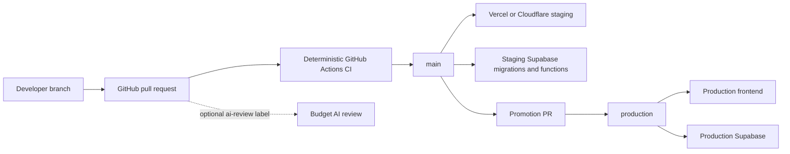

# ResumePreps infrastructure decision

Decision date: 2026-07-17
Decision: managed serverless deployment and GitHub Actions; no Jenkins or Kubernetes

## Selected architecture

Use:

- GitHub Actions for type checking, changed-file linting, tests, builds, dependency auditing, and deployment orchestration;
- Vercel preview deployments while developing;
- Supabase for authentication, database, storage, scheduled work, and edge functions;
- Dependabot for weekly npm updates and monthly GitHub Actions updates;
- an optional, advisory OpenAI review for selected pull requests.

Do not add:

- Jenkins controllers or agents;
- Kubernetes clusters, Helm, an ingress controller, a container registry, or cluster monitoring;
- AI calls for tasks that ESLint, TypeScript, tests, SQL constraints, or deterministic scripts can decide.

## Why Jenkins is rejected

[Jenkins](https://www.jenkins.io/doc/) is open-source, but it must run on a machine with Java and persistent storage. A reliable setup also needs controller upgrades, plugin security maintenance, backups, credentials, build agents, monitoring, and recovery. The software license is free; operating it is not.

GitHub Actions already provides managed runners, repository events, secrets, pull-request checks, environments, concurrency, logs, and deployment approvals. [Standard runners are free for public repositories](https://docs.github.com/en/billing/concepts/product-billing/github-actions), which makes it the lower-cost and lower-risk choice for this repository.

## Why Kubernetes is rejected

Kubernetes solves scheduling and operating many containerized services. ResumePreps currently has a static React frontend and managed Supabase functions, not a fleet of container services. Kubernetes would introduce control-plane/node cost, network policy, TLS/ingress, secrets, autoscaling, upgrades, backups, observability, and incident response. The official [production Kubernetes guidance](https://kubernetes.io/docs/setup/production-environment/) explicitly treats production clusters as substantially more involved than learning environments.

Reconsider managed Kubernetes only when all of these become true:

- at least several long-running container services cannot run economically on managed serverless platforms;
- background browser workers require stable pooled compute at material volume;
- measured serverless spend exceeds a managed-cluster total-cost estimate;
- at least two engineers can own platform operations and on-call response;
- container, security, observability, backup, and disaster-recovery standards already exist.

## Frontend hosting cost decision

Vercel is technically appropriate and easy to operate. The current limitation is plan policy: [Vercel Hobby is free but restricted to personal, non-commercial use](https://vercel.com/docs/plans/hobby). ResumePreps can use it for development and private validation, but a paid subscription launch should not remain on Hobby.

Two acceptable launch choices:

1. Keep Vercel and move to Pro when commercial subscriptions begin. This minimizes migration and operational risk.
2. Move the static Vite frontend to Cloudflare Pages before monetization if the objective remains `$0` frontend hosting. Cloudflare documents 500 free builds per month and free, unlimited static-asset requests within its [Pages limits](https://developers.cloudflare.com/pages/platform/limits/) and [Pages pricing](https://developers.cloudflare.com/pages/functions/pricing/). Supabase remains the backend in either case.

Do not move hosting merely to add infrastructure. Run a staging Cloudflare proof before changing DNS, verify SPA rewrites, OAuth redirect URLs, CSP, analytics, custom domains, and rollback.

## Cost-controlled AI policy

The normal quality gate makes no AI calls. The optional `.github/workflows/ai-review.yml` workflow runs only when:

- repository variable `ENABLE_AI_REVIEW` equals `1`;
- a pull request carries the `ai-review` label, or the workflow is manually dispatched;
- `OPENAI_API_KEY` exists as a GitHub Actions secret.

Defaults:

- model: `gpt-5.4-nano`;
- reasoning effort: low;
- maximum input: 30,000 characters of redacted diff;
- maximum output: 900 tokens;
- concurrency: one active review per pull request;
- role: advisory only—never an automatic merge approval.

For pull requests, CI executes the reviewer script from the trusted base commit rather than the proposed branch. The reviewed diff remains untrusted input, but a contributor cannot replace the script that receives the dedicated OpenAI key. Fork pull requests do not receive repository secrets; the same trusted-script rule is retained for internal branches.

OpenAI describes [GPT-5.4 nano](https://developers.openai.com/api/docs/models/gpt-5.4-nano) as its cheapest GPT-5.4-class model for high-volume classification, extraction, ranking, and sub-agent work. Use `gpt-5.4-mini` only when an evaluation proves that nano misses important defects. Do not use frontier models for routine CI review.

Recommended GitHub configuration:

| Setting | Value |
|---|---|
| Actions variable `ENABLE_AI_REVIEW` | `0` initially; change to `1` after one manual dry run |
| Actions variable `AI_REVIEW_MODEL` | `gpt-5.4-nano` |
| Actions variable `AI_REVIEW_MAX_INPUT_CHARS` | `30000` |
| Actions variable `AI_REVIEW_MAX_OUTPUT_TOKENS` | `900` |
| Actions secret `OPENAI_API_KEY` | dedicated key/project with a small monthly budget |
| Legacy variable `ENABLE_CLAUDE_AGENT` | `0` |

Set a provider-side monthly project budget and alert. The workflow token cap limits each request but cannot replace an account-level spend ceiling.

## Managed release workflow

1. Pull request runs dependency audit, type check, changed-file lint, all tests, and production build.
2. Add `ai-review` only for authentication, billing, migrations, application submission, security, or complicated cross-module changes.
3. Merge to `main` deploys staging frontend through the hosting provider and staging database/functions through GitHub Actions.
4. Validate staging using `docs/release-runbook.md`.
5. Promote the same commit from `main` to `production` through a reviewed pull request.
6. The protected production GitHub environment approves production Supabase deployment.
7. Roll back frontend/functions by reverting the release; use forward-only fixes for additive database migrations.

This architecture is the easiest managed option available now. It avoids paying for idle infrastructure and keeps the future option to move the frontend or browser workers independently.
