# Job search and application-agent architecture

Updated: 2026-07-18

## Product contract

ResumePreps must distinguish five states that competitors often blur:

1. **Discovered** — a canonical, live employer posting exists.
2. **Eligible** — the role passes the user's country, work mode, seniority,
   experience, compensation, sponsorship, and exclusion rules.
3. **Prepared** — a source-preserving tailored resume, ATS result, and required
   answers exist.
4. **Queued** — the user or policy authorized an attempt on a supported portal.
5. **Submitted** — the portal returned a verifiable receipt or confirmation.

Only the last state may be shown as “applied.” Unsupported portals remain a
review/manual action; a click or a generated document is not a submission.

## Selected pipeline

```mermaid
flowchart LR
  A["Public employer ATS APIs"] --> B["Scheduled zero-model scan"]
  W["Metered search fallback"] --> B
  B --> C["Normalize + canonical URL"]
  C --> D["Deduplicate + freshness"]
  D --> E["Hard eligibility filters"]
  E --> F["Explainable 0-100 fit score"]
  F --> G["User match feed"]
  G --> H["Source-preserving tailored copy"]
  H --> I["ATS dimensions + evidence"]
  I --> J{"Submission policy"}
  J -->|Ask first| K["Review queue"]
  J -->|Eligible auto-submit| L["Supported portal adapter"]
  K --> L
  L --> M["Receipt / failed / skipped audit"]
```

### Discovery

- `career-ops-scan` reads public Greenhouse, Ashby, and Lever posting APIs with
  no model call and upserts `scanned_jobs`.
- The public ATS feeds are canonical for title, location, description, posting
  ID, and apply URL. Greenhouse GET endpoints are public; Lever and Ashby expose
  public posting feeds.
- `perplexity-job-search` is now an authenticated, direct-employer-only,
  DB-first fallback. It cannot accept a caller-supplied user ID, rejects
  aggregator URLs, and meters provider cache misses separately.
- One central scan is reused across accounts. A page refresh must never start a
  new crawl for every user.

### Matching

- `career-ops-evaluate` owns the authoritative deterministic fit decision.
- Hard filters run before ranking and cannot be overridden by a model.
- The saved decision contains score, confidence, evidence by dimension, gaps,
  and the exact score version.
- The Job Search “Matched For You,” Matches, Agent, tailoring, and submission
  paths all read `job_evaluations`; legacy `job_matches` is no longer a second
  source of truth.

### Resume and ATS

- The imported resume is the source artifact.
- “Tailor to job” creates a separate resume row; it never overwrites the source.
- Parsing and substantive tailoring default to `gpt-5.4-mini`. Classification,
  routing, and short conversational work default to `gpt-5.4-nano`. Every model
  remains environment-overridable.
- The ATS preview reports format, keywords, experience, skills, education, and
  impact. Scores are evidence for improvement, not a promise of an interview.

### Submission

- Greenhouse, Lever, and similar application POST APIs generally require an API
  credential owned by the hiring employer; ResumePreps does not possess a
  universal submission API key.
- Therefore launch submission uses explicit supported adapters and observable
  browser/local autofill. CAPTCHAs, identity attestations, EEO answers, and
  uncertain questions stop for user review.
- Policy options are “Ask before submit” and “Submit eligible automatically.”
  Automatic mode still requires eligibility, fit threshold, portal support,
  daily cap, monthly infrastructure cap, and a source resume.

## Reliability and cost controls

- Keep Vercel for previews and the React frontend; commercial production must
  use Vercel Pro or a validated alternative because Hobby is non-commercial.
- Keep Supabase for Postgres, Auth, Storage, Edge Functions, Cron, and RLS.
- Adopt Supabase Queues (`pgmq`) when submission volume exceeds the current
  database task queue. It provides durable delivery and visibility timeouts
  without adding Redis, Jenkins, or Kubernetes.
- Use Cron for bounded scan/orchestrator wake-ups, not an always-awake browser.
- Use GitHub Actions for deterministic CI. Manual incident repair may invoke
  `openai/codex-action`, but it can only propose an allowlisted patch that a
  clean runner audits, tests, builds, and opens as a draft dev PR.
- Do not add Kubernetes until measured always-on worker spend, workload count,
  and operational staffing justify a cluster.

## Observability

- Browser failures are sanitized, fingerprinted, deduplicated, and recorded in
  `app_incidents`; raw resume content, form values, query strings, tokens, and
  credentials are excluded.
- Agent and application records preserve inputs, policy, status, timestamps,
  attempts, and receipts.
- A manual incident workflow takes a staging incident UUID. It does not run on
  a schedule, touch protected paths, merge a PR, or deploy production.

## Delivery order

1. Ship the unified dev UI and data path; validate parsing, matching, tailoring,
   ATS scoring, review mode, and supported Greenhouse submission with synthetic
   accounts.
2. Move the existing application task table to `pgmq` only after load tests show
   queue contention or retry ambiguity.
3. Add Lever/Ashby submission adapters only where terms and employer credentials
   permit them; otherwise keep browser/manual status explicit.
4. Add centralized search quality metrics: freshness, canonical-URL rate,
   duplicate rate, eligibility rate, preparation success, submission receipt
   rate, and interview conversion.
5. Promote the exact tested commit from `develop` to `main` through the
   protected production environment. No incident agent bypasses this release
   path.

## Primary references

- [Greenhouse Job Board API](https://developers.greenhouse.io/job-board.html)
- [Lever Postings API](https://github.com/lever/postings-api)
- [Ashby public job posting API](https://developers.ashbyhq.com/docs/public-job-posting-api)
- [Supabase Cron](https://supabase.com/docs/guides/cron)
- [Supabase Queues](https://supabase.com/docs/guides/queues)
- [OpenAI Codex GitHub Action](https://github.com/openai/codex-action)
- [Vercel Hobby plan](https://vercel.com/docs/plans/hobby)
