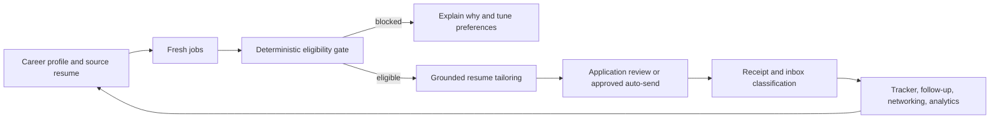

# ResumePreps product rescue blueprint

Status: first foundation slice implemented on `codex/product-rescue-foundation`
Audit date: 2026-07-17
Scope: live ResumePreps, signed-in Tsenta and Jobright workflows, repository, public competitor products, release process, safety, and AI cost design

## Executive decision

ResumePreps does not need more disconnected generators. It needs one durable career profile and one explainable decision record that every feature consumes.

The product should be organized around this loop:

The durable differentiator is not application volume. It is a trustworthy career model: accurate level and experience fit, evidence-backed tailoring, explicit controls, verifiable receipts, and learning from outcomes.

## What the live audit found

### ResumePreps

The visual system is distinctive and should stay. The product already has useful surfaces for search, matches, collections, resume building, ATS analysis, applications, cover letters, interviews, chat, documents, auto-apply, and analytics.

The underlying workflow is fragmented:

- Multiple tools ask the user to paste or upload the same resume again instead of using one canonical career profile.
- Matches currently start from title substring filters and a language-model score, not hard experience, seniority, country, work-mode, authorization, and salary rules.
- The live Profile route fails because it queries a `phone` column that was never added to the database. It then shows placeholder identity data.
- Auto Apply is marketed in several inconsistent ways: the navigation promotes Greenhouse auto-apply, the locked page promises 50+ jobs per day, and the implementation is not a verified multi-step submission system.
- The application tracker is a manual board, while inbox, submission receipts, documents, and status changes are separate systems.
- The repository has broad functionality but large, duplicated pages and 39 edge functions. The baseline type check, tests, and build pass; the full lint suite has hundreds of pre-existing issues and was not part of CI.
- The previous QA seeder stored shared passwords in source and explicitly encouraged production seeding.
- The hourly job-hunter used a multi-turn reasoning model for a deterministic queueing decision. Its service-to-service calls also lacked a safe way to act for the intended user.
- The browser worker treated “Continue” as a possible final submit and marked an application submitted after a click without verifying a receipt.

### Tsenta

The strongest product lesson is the connected workflow:

- dashboard, fresh jobs, applications, inbox, tracker, networking, resume, and profile share one state;
- application rows expose submitted, in-flight, needs-user, failed, and skipped outcomes;
- the inbox classifies verification, rejection, interview, assessment, reminder, offer, and applied messages;
- email aliases and connected email support application receipts and OTP workflows;
- resume rules and formatting preferences persist across future tailoring;
- the profile stores experience, education, skills, work authorization, work preferences, and recurring ATS answers;
- networking begins from companies in the application pipeline;
- its newer review-before-submit flow exposes filled answers and documents before the final action.

The biggest weakness is permissive fit. In the audited account, individual-contributor, staff/principal, and executive roles appeared with very similar match scores. That confirms that keyword similarity is outweighing credible career level.

### Jobright authenticated workflow

The authenticated audit used an account with real job and application history and made no applications, messages, uploads, profile changes, or account changes. No account-specific personal data is retained in this document.

The strongest patterns are:

- recommendation cards explain fit with separate experience-level, skills, and industry-experience scores, then summarize an overall match band;
- filters cover function, excluded titles, employment type, work model, country/radius, seniority, required experience, recency, compensation, sponsorship, clearance/citizenship restrictions, industries, skills, IC/manager preference, company stage, staffing agencies, and excluded companies;
- the Agent separates `Supervised` and `Automated` modes, lets the user choose a weekly application objective, and keeps per-application resume tailoring and cover-letter generation as explicit settings;
- agent work has observable queue states such as jobs added, awaiting start, custom resume generated, confirmation required, action required, and application complete;
- the user selects jobs before the supervised agent starts, preserving a clear human approval boundary;
- the resume system stores a primary resume, renders it as structured editable sections, grades it, reports urgent/critical/optional issues, and exposes issue-specific fixes;
- the tracker uses applied, interviewing, offer received, rejected, and archived stages and connects those applications to company-specific interview-question packs;
- job details add original-post links, normalized responsibilities and qualifications, company context, sponsorship history, funding stage, leadership, and recent news;
- instant and digest job alerts are separately controlled, and the inbox is a notification surface rather than the application source of truth;
- autofill is positioned as a browser extension across major ATS platforms, while the agent is the higher-level queue, tailoring, approval, and tracking workflow.

Important weaknesses to avoid copying:

- the resume analysis can label a document “excellent” while simultaneously surfacing critical and urgent issues, which weakens score semantics;
- applied history can contain jobs with weak dimension scores, so the product still needs deterministic eligibility gates before volume automation;
- profile and resume loading showed transient empty states before data appeared, creating avoidable trust risk;
- the message center contained no application receipts despite extensive applied history, so tracker claims and evidence are not visibly unified;
- application stages are user-editable status labels, but the audited surfaces did not expose a verified submission receipt or a detailed ATS attempt timeline.

ResumePreps should adopt the observable queue, granular controls, structured resume editor, and application-linked interview preparation. It should differentiate with hard eligibility blocks, internally consistent scoring, immutable event history, and receipt-backed submission states.

## Market map

| Product | Publicly emphasized strengths | Product implication for ResumePreps |
|---|---|---|
| [Tsenta](https://tsenta.com/) | Career-page monitoring, ATS coverage, tailored documents, application receipts, review controls | Match the connected workflow; win on eligibility accuracy and evidence |
| [Jobright AI](https://jobright.ai/) | Personalized matches, autofill, resume AI, networking, H-1B search, tracker | Visa-aware search and networking are expected, not premium differentiation |
| [Sprout](https://www.usesprout.com/features/ai-job-application) | Matching, tailored documents, application automation, user approval | Make approval policy explicit and visible on every application |
| [Simplify Copilot](https://simplify.jobs/copilot) | Broad ATS autofill, answer memory, keyword score, tracker | Autofill alone is becoming a free acquisition feature |
| [ApplyRight](https://applyright.co.in/) | Ranked matches, autofill, resume analysis, interview preparation | The journey must continue through interview preparation |
| [Hustle Hive](https://hustlehive.ai/products/ai-job-copilot) | AI automation plus human supervision | Trust and review quality can justify subscription pricing |
| [LoopCV](https://www.loopcv.pro/pricing/index.html) | Job discovery, auto-apply, email follow-up, tracking | Follow-up automation belongs in the core loop |
| [Sonara](https://www.sonara.ai/) | Continuous job discovery and application | “Always on” is table stakes; relevance and receipts are the quality moat |

## Product architecture

### 1. Canonical career profile

Store a versioned, provenance-aware profile:

- identity and contact fields;
- work history with non-overlapping calculated experience;
- role families and credible seniority;
- skills linked to the resume bullet or project that proves each skill;
- education, certifications, projects, work authorization, sponsorship need;
- countries, locations, work modes, employment types, compensation, exclusions;
- saved ATS answers with user approval and last-used timestamp;
- resume formatting and tailoring rules.

Every resume, match, application, interview, networking message, and analytic event must reference a profile version.

### 2. Career-fit gate

`career-fit-v1` is implemented as deterministic code. It calculates:

- role-family alignment;
- demonstrated skill coverage;
- calculated years and seniority fit;
- country, location, and work-mode fit;
- compensation fit;
- authorization and sponsorship fit;
- score confidence based on the quality of the posting data.

Hard filters are authoritative. The language model explains the result but cannot clear a block. The stored decision includes the 0–100 score, eligibility, confidence, dimension evidence, gaps, inferred job attributes, and scoring version.

### 3. Grounded tailoring

Tailoring must operate on claims, not free-form text:

1. select source bullets with evidence for the job;
2. reorder and rephrase without changing employer, title, dates, tools, or metrics;
3. validate every output claim against the source claim graph;
4. render the selected template with locked typographic rules;
5. run parsing, overflow, hyperlink, font, and text-extraction checks;
6. show a change set before approval when policy requires it.

“ATS score” must be separated into honest concepts:

- parseability and document hygiene;
- job keyword/evidence coverage;
- career-fit eligibility;
- content quality.

No product can guarantee a universal ATS pass because employer configurations differ.

### 4. Application state machine

Use explicit states rather than one `submitted` flag:

`discovered → evaluated → blocked | eligible → tailored → needs_review | approved → filling → needs_user | submitted → receipt_verified | failed | skipped`

Each transition must record actor, timestamp, input document versions, answers, failure code, and evidence. A click is not a submission. `receipt_verified` requires a supported ATS response, confirmation page, or confirmation email.

No CAPTCHA bypass, bot-evasion technique, residential proxy scheme, or terms-of-service circumvention belongs in the product. Use supported integrations, user-controlled browser assistance, and honest rate limits.

### 5. Inbox and OTP

Build this in stages:

1. generated application alias and forwarding;
2. Gmail OAuth with the narrowest feasible read scope;
3. message classification and application linking;
4. one-time-code detection with short retention and no logging of the code;
5. user-visible consent, disconnect, deletion, and audit controls;
6. auto-use only inside a currently authorized application session.

The inbox is not just an email viewer. It should drive tracker transitions, reminders, interview preparation, rejection learning, and follow-up suggestions.

## AI model and cost policy

Use deterministic code before models whenever the rule can be specified and tested.

| Workload | Default | Notes |
|---|---|---|
| Experience calculation, hard filters, ranking, queue decisions | No model | Deterministic and versioned |
| Extraction, classification, short explanations | `gpt-5.4-nano` | Cheap tier, environment-overridable |
| Resume tailoring, complex drafting | `gpt-5.4-mini` | Standard tier, grounded output validation required |
| Rare ambiguous planning | `gpt-5.4-mini` initially | Promote only with measured quality evidence |

The router now defaults to OpenAI but retains provider fallback and environment overrides. Current model availability and pricing should be rechecked before each production change against the [official model catalog](https://developers.openai.com/api/docs/models), [GPT-5.4 nano](https://developers.openai.com/api/docs/models/gpt-5.4-nano), and [GPT-5.4 mini](https://developers.openai.com/api/docs/models/gpt-5.4-mini).

Cost controls:

- hash and cache resume/job inputs;
- never rescore an unchanged `(profile_version, job_version, score_version)` tuple;
- use structured outputs and bounded contexts;
- log tokens and cost by feature and user;
- set daily per-feature budgets and global spend alerts;
- run offline evaluation sets before changing prompts or models;
- keep auto-pilot orchestration model-free.

## Subscription hypothesis

Do not keep the current isolated `$120/month` Auto Apply paywall as the primary offer. It is far above several public automation competitors while the underlying workflow is not yet complete. Test value-based bundles only after the golden path has reliable receipts:

| Tier | Initial hypothesis | Included value |
|---|---:|---|
| Free | $0 | Canonical profile, job search, explainable matches, tracker, browser-assisted autofill, 3 tailored applications/month |
| Career Pro | $19/month | 100 tailored review-ready applications/month, resume versions, inbox classification, interview packs, follow-up drafts |
| Autopilot | $39/month | 300 approved applications/month, continuous monitoring, verified receipts, priority adapters, networking assistant |

These are experiment prices, not promises. Daily safety limits should remain even on paid plans. Measure retained subscribers, interview rate, verified submissions, support cost, and AI/automation cost per subscriber before changing quotas. Never sell “unlimited applications” until reliability, employer-platform rules, and abuse controls are proven.

## Delivery sequence

### Foundation — implemented in this branch

- explainable career-fit engine and tests;
- richer preference schema and UI;
- hard-blocked preparation in UI and backend;
- fit score, confidence, evidence, and hard-filter persistence;
- profile schema fix for the live failure;
- low-cost OpenAI routing defaults with fallback;
- deterministic hourly orchestration;
- safe service-to-service user context;
- browser worker consent and receipt verification guard;
- dependency vulnerabilities reduced to zero;
- secure environment-specific QA account seeding;
- staging migration deployment and security gate additions.

### Next: make one golden path complete

1. onboarding creates the canonical profile and validates calculated experience;
2. job ingestion normalizes country, work mode, experience, salary, authorization, and ATS type;
3. Matches scores every surfaced role automatically and exposes all six dimensions;
4. one supported ATS adapter completes multi-step filling, document upload, review, final submit, and receipt verification;
5. the tracker consumes application events instead of manual duplicates;
6. inbox classification updates tracker states;
7. analytics measures interview rate by fit band, resume version, and source.

Start with Greenhouse, then add Lever and Ashby behind adapter contract tests. Workday should remain assisted/reviewed until its flows and account constraints are proven reliable.

### Then: differentiation

- outcome-calibrated ranking per candidate, not generic match scoring;
- networking paths from applied companies and alumni/first-degree context;
- follow-up drafts tied to application state and timing;
- interview packs generated from the exact job, tailored resume, and evidence gaps;
- career-story consistency checks across resume, application answers, profile, and interview responses;
- recruiter-facing portfolio and verified proof artifacts.

## Success measures

Quality must beat volume:

- eligible-match precision at top 10;
- user rejection rate of recommended jobs;
- tailoring claim-violation rate (target zero);
- application receipt verification rate;
- needs-user and failure rate per ATS adapter;
- interview rate by fit-score band;
- time from signup to first review-ready application;
- cost per evaluated job and per submitted application;
- Gmail disconnect/deletion SLA and privacy incidents.
